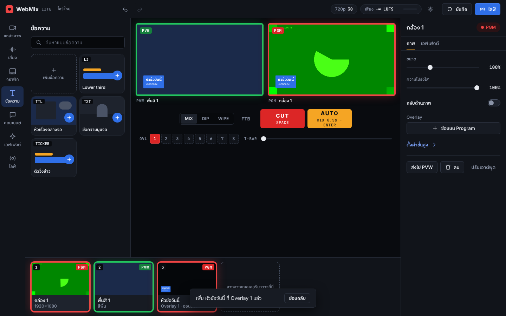
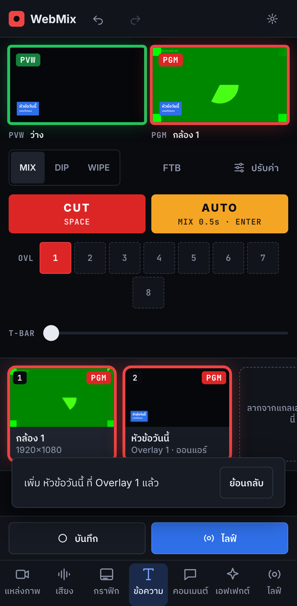

# WebMix Studio Lite

สวิตเชอร์ไลฟ์ที่รันในเบราว์เซอร์ได้ทันที ไม่ต้องติดตั้งโปรแกรม เลือกหมวดทางซ้าย หยิบของจากแกลเลอรี ตัดภาพบนจอ PVW / PGM แล้วปรับรายละเอียดในแผงขวา หน้าตาและพฤติกรรมทั้งหมดทำตาม **WebMix Design System** (เก็บไว้ที่ [`design/`](design/))

**เปิดใช้งาน:** https://jugkritso-png.github.io/webmix-studio-lite/



## ใช้งาน

1. **เพิ่มแหล่งภาพ** แตะหมวด "แหล่งภาพ" แล้วแตะไทล์ (กล้อง, แชร์หน้าจอ, ไฟล์วิดีโอ, รูปภาพ, พื้นสี) หรือลากไทล์ไปวางบนจอ PVW / PGM หรือแถบการ์ดด้านล่าง
2. **เลือกภาพถัดไป** แตะการ์ดหรือกดเลข `1`–`9` เพื่อส่งไปจอ PVW (ซ้าย)
3. **ตัดภาพ** กด `CUT` (`Space`) เพื่อตัดทันที หรือ `AUTO` (`Enter`) เพื่อเปลี่ยนแบบ MIX, DIP (ผ่านจอดำ) หรือ WIPE แตะการ์ดสองครั้ง หรือกดเลขเดิมซ้ำ ก็ตัดขึ้น PGM ได้เลย เลื่อน **T-Bar** เพื่อเปลี่ยนภาพเองตามจังหวะ (ปล่อยกลางทางได้ กด AUTO เพื่อไปต่อ) และ **FTB** (`B`) พาจอ PGM ค่อย ๆ ดำ
   - แหล่งสัญญาณในตัว: Color Bars, Slate ข้อความ, นาฬิกา, จอดำ
   - ไฟล์วิดีโอและ **เพลย์ลิสต์** (เลือกได้หลายไฟล์): รออยู่ที่เฟรมแรกตอนอยู่ PVW, **เล่นเองเมื่อขึ้น PGM และหยุดเมื่อลง** (ปิดได้), การ์ดบอกสถานะและเวลาที่เหลือ (`เล่น −00:12`, `จบแล้ว`) แท็บ "เล่น" มีเล่น / หยุด, เริ่มใหม่, เลื่อนตำแหน่ง, ไฟล์ก่อน / ถัดไป, เล่นวน (ปิดอยู่เป็นค่าเริ่มต้น) และ "เริ่มจากต้นทุกครั้งที่ขึ้น PGM" · ไฟล์ที่เบราว์เซอร์เล่นไม่ได้จะแจ้งให้แปลงเป็น MP4 (H.264) หรือ WebM
   - กล้องเลือกความละเอียด 720p / 1080p / 4K ได้ใน "ตั้งค่าขั้นสูง"
4. **ปรับค่า** แตะการ์ดแล้วปรับในแผงขวา: ขนาด, ความโปร่งใส, กลับด้าน, แสดงซ้อนบนจอ ค่าอื่น ๆ (ตำแหน่ง, การจัดภาพ, ชื่อ) อยู่ใน "ตั้งค่าขั้นสูง" ถ้าไม่ได้เลือกอะไร แผงนี้ปรับเอาต์พุต: ระยะเวลา AUTO, ระดับเสียงรวม, ความละเอียดถึง **4K** และ 30 / 60 fps, FTB, เปิด **หน้าต่าง Program** แยก (ลากไปจอที่สองหรือโปรเจกเตอร์ ดับเบิลคลิกเพื่อเต็มจอ), **Multiview** (PVW, PGM และ 8 แหล่งภาพพร้อม tally), เต็มจอ และถ่ายภาพนิ่ง PNG
5. **ข้อความ / กราฟิก / คอมเมนต์ (Overlay 1–8)** กราฟิกทุกชิ้นอยู่บนช่อง Overlay 1–8 ซ้อนบน Program โดยไม่แตะภาพหลัก กดปุ่ม 1–8 ในแถว OVL ใต้ CUT / AUTO หรือ `Shift+1`–`Shift+8` เพื่อขึ้น / ลง (กดเลขการ์ดของกราฟิกก็ได้) ตั้งช่อง เอฟเฟกต์เข้า-ออก (Cut, Fade, Zoom, Slide ←→↑↓, Wipe) และระยะเวลาใน "ตั้งค่าขั้นสูง" หลังเปิดหน้าใหม่กราฟิกจะไม่ขึ้นจอเอง ปุ่ม Overlay ที่ยังว่างแตะเพื่อเลือกสิ่งที่จะซ้อนได้เลย (กล้อง / วิดีโอเต็มจอจะย่อเป็นภาพซ้อนให้) และเปิด "แสดงบน PVW ก่อน" เพื่อตรวจกราฟิกบนจอ PVW ก่อนขึ้นจริง (ปุ่มขอบเขียว)
   - Lower third, หัวเรื่อง, ป้ายมุมจอ, การ์ดคอมเมนต์, **ตัววิ่งข่าว** (บรรทัดละเรื่อง ปรับความเร็วได้) และ **ป้ายที่บันทึกไว้** แตะเพื่อสลับชื่อ / ตำแหน่งระหว่างไลฟ์
   - **ป้ายคะแนน** ปุ่ม + / − ของแต่ละทีม, ช่วงเวลา, สีทีม · **นับถอยหลัง / จับเวลา** เริ่ม หยุด เริ่มใหม่
   - **ภาพซ้อน (PIP)** เลือกกล้อง / หน้าจอ / วิดีโอให้ย่อลงมุมจอ ปรับตำแหน่ง ครอป 4 ด้าน และขอบ
   - **คีย์ฉากเขียว / ฟ้า** (แท็บเอฟเฟกต์) ทำบนการ์ดจอด้วย WebGL ปรับความไวได้
   - **ข้อมูลจาก Google Sheets / CSV** (แท็บข้อมูล) ดึงใหม่ทุก 10 วินาที: ป้ายชื่อใช้คอลัมน์ A, B และเลื่อนแถวได้ · ป้ายคะแนนใช้แถวแรก (ทีม A, คะแนน A, ทีม B, คะแนน B, ช่วงเวลา) · ตัววิ่งใช้คอลัมน์ A ทุกแถว ชีตต้องแชร์แบบ "ทุกคนที่มีลิงก์ดูได้"
6. **เสียงระดับ Pro** มิกเซอร์ในหมวด "เสียง": มิเตอร์ **dBFS** พร้อมค้างค่าพีก (เขียว / อำพันเกิน −6 / แดงใกล้แตก), เฟดเดอร์บอกค่า dB, ปุ่ม Mute และ **MON** (ฟังเฉพาะช่องนั้นในหูฟัง), Master พร้อม **ลิมิตเตอร์** (ไฟ LIM แดงเมื่อกำลังลดเสียง) และวัดความดัง **LUFS** แบบ EBU R128 (Momentary / Short-term / Integrated กดรีเซ็ตได้)
   - แท็บเสียงของแต่ละช่อง: **Noise gate**, ตัดเสียงทุ้ม 80 Hz, **EQ 3 ย่าน** (120 Hz / 1 kHz / 8 kHz ±12 dB), **คอมเพรสเซอร์** 4:1, **หน่วงเสียง** 0–1000 ms ให้ตรงปาก, ซ้าย / ขวา และ AFV (ไฟล์วิดีโอเปิดเสียงเฉพาะตอนออกอากาศ)
   - เลือกลำโพง / หูฟังสำหรับฟังเสียงได้ใน "เอาต์พุต → ตั้งค่าขั้นสูง" (Chrome / Edge)
7. **เอฟเฟกต์** แตะเพื่อใส่ให้แหล่งภาพที่เลือก หรือลากไปวางบนจอ
8. **บันทึก** กดปุ่ม "บันทึก" มุมขวาบนเพื่อบันทึกภาพและเสียง PGM กดอีกครั้งเพื่อหยุดแล้วดาวน์โหลดไฟล์ `.webm`
9. **ย้อนกลับได้เสมอ** ทุกการลบหรือเพิ่มจะมีแถบ "ย้อนกลับ" 5 วินาที และใช้ `⌘Z` / `Ctrl+Z` (ทำซ้ำ `⇧⌘Z` / `Ctrl+Y`) ได้ตลอด

ฉากบันทึกในเบราว์เซอร์ (localStorage) อัตโนมัติ เปิดหน้าใหม่แล้วข้อความ กราฟิก พื้นสี และรูปขนาดไม่เกิน ~1 MB กลับมาครบ ไฟล์วิดีโอ เพลย์ลิสต์ ไฟล์เสียง และรูปขนาดใหญ่เก็บสำเนาไว้ในเบราว์เซอร์ จึงกลับมาเองโดยไม่ต้องเลือกไฟล์ใหม่ กล้องจะเชื่อมต่อเองถ้าเคยอนุญาตแล้ว ส่วนแชร์หน้าจอต้องกด "เชื่อมต่อใหม่" ในแผงขวา

### คีย์ลัด

| คีย์ | ทำอะไร |
|---|---|
| `Space` | CUT |
| `Enter` | AUTO |
| `B` | FTB จอดำ เปิด / ปิด |
| `1`–`9` | ส่งไป PVW · กดเลขเดิมซ้ำภายใน 1 วินาทีเพื่อ CUT · ถ้าเป็นกราฟิก = ขึ้น / ลงจอ |
| `Shift+1`–`Shift+8` | Overlay 1–8 ขึ้น / ลง |
| `⌘Z` / `Ctrl+Z` | ย้อนกลับ |
| `⇧⌘Z` / `Ctrl+Y` | ทำซ้ำ |
| `Delete` | ลบแหล่งภาพที่เลือก |
| `Esc` | ปิดแผ่นแกลเลอรี / แผงปรับค่า |

### ไลฟ์หลายปลายทาง

กดปุ่ม **ไลฟ์** มุมขวาบน (หรือไทล์ในหมวด "ไลฟ์"):

1. ใส่ที่อยู่ **Stream Gateway** เช่น `wss://live.example.com/?token=…` (ดูวิธีติดตั้งด้านล่าง)
2. ตั้งปลายทางได้สูงสุด 6 ช่อง: YouTube, Facebook, Twitch, RTMP อื่น ๆ หรือ SRT แล้ววางคีย์สตรีม
3. กด **ตรวจคีย์** เพื่อเช็กว่าคีย์ใช้ได้โดยยังไม่ขึ้นไลฟ์ แล้วกด **เริ่มช่องนี้** ทีละช่อง หรือ **เริ่มทั้งหมด**
4. ระหว่างไลฟ์ ปุ่มด้านบนเป็น `LIVE 00:12:34` แต่ละช่องแสดงสถานะและ kbps เพิ่มหรือหยุดทีละช่องได้ ถ้า Gateway หลุดจะต่อใหม่เองทุก 3 วินาที การ **หยุดไลฟ์ทั้งหมด** จะถามยืนยันก่อน

อินเทอร์เน็ตขาขึ้นของเครื่องนี้ใช้เท่ากับสตรีมเดียว ไม่ว่าจะส่งกี่ปลายทาง บิตเรตตั้งได้ในหน้าไลฟ์ (อัตโนมัติตามความละเอียด: 720p 4.5 Mbps, 1080p 6 Mbps, 4K 20 Mbps)
**คีย์สตรีมอยู่ในหน่วยความจำเท่านั้น ไม่ถูกบันทึกที่ใด** ที่อยู่ Gateway (มี token) จำไว้เฉพาะแท็บนี้ ปิดแท็บแล้วต้องใส่ใหม่

### Stream Gateway

เบราว์เซอร์ส่ง RTMP / SRT เองไม่ได้ Lite ส่งภาพ Program ผ่าน WebSocket ให้ **Stream Gateway ตัวเดียวกับ WebMix Pro** ([jugkritso-png/webswither/server](https://github.com/jugkritso-png/webswither/tree/HEAD/server)) ซึ่งเข้ารหัส H.264 / AAC ด้วย FFmpeg ครั้งเดียวแล้วกระจายไปทุกปลายทาง

ติดตั้งบน VPS (Ubuntu 22.04 / 24.04 หรือ Debian 12, 720p ใช้ 2 vCPU / 2 GB, 1080p ใช้ 4 vCPU / 4 GB):

1. เปิดพอร์ต TCP 80, 443 (และ TCP+UDP 3478, UDP 49160–49250 ถ้าจะใช้กล้องมือถือผ่าน 4G / 5G)
2. รันคำสั่งเดียว:

   ```bash
   curl -fsSL https://raw.githubusercontent.com/jugkritso-png/webswither/HEAD/server/deploy/install.sh | sudo bash
   ```

3. คัดลอกค่า `wss://…/?token=…` ที่สคริปต์แสดง มาใส่ช่อง Stream Gateway ในหน้าไลฟ์

รายละเอียดเพิ่ม (โดเมนของตัวเอง, การ์ดจอ NVIDIA, token แยกรายคน, การอัปเดต) อยู่ใน README ของ WebMix Pro หัวข้อ "สตรีมสด"

### กล้องมือถือและแขกรับเชิญทางไกล

- **กล้องมือถือ (QR)** หมวดแหล่งภาพ → สแกน QR ด้วยมือถือ → ใส่ชื่อ → เชื่อมต่อ ภาพขึ้นเป็นการ์ดใหม่ มือถือเห็นกรอบ **ON AIR** (แดง) / **PREVIEW** (เขียว) สลับกล้องหน้า / หลัง ปิดไมค์ และเลือก HD / FHD / 4K ได้ หน้าจอไม่ดับระหว่างส่ง
- **แขกรับเชิญทางไกล** ตั้งชื่อแขกแล้วส่งลิงก์ทาง LINE / อีเมล แขกเปิดในเบราว์เซอร์ (ไม่ต้องติดตั้งแอป) จะ**เห็นและได้ยินรายการ** โดยไม่ได้ยินเสียงตัวเอง (mix-minus)
- สายหลุดหรือรีเฟรชสตูดิโอ มือถือ / แขกจะเชื่อมต่อกลับเข้าการ์ดเดิมเอง
- ไม่ต้องมี Gateway: ใช้ระบบจับคู่สาธารณะของ PeerJS ได้กับ Wi-Fi ส่วนใหญ่ ถ้ามือถือใช้ 4G / 5G หรือ Wi-Fi บริษัทแล้วต่อไม่ติด ให้ใส่ Gateway ในหน้าไลฟ์ Lite จะใช้ PeerJS + TURN ของ Gateway ให้เอง

### หน้าจอแต่ละขนาด

- **เดสก์ท็อป** แถบหมวด → แกลเลอรี → เวที (PVW / PGM) → แผงปรับค่า และแถบการ์ดด้านล่าง
- **แท็บเล็ต** (< 1200px) แกลเลอรีเป็นแผ่นที่เลื่อนออกจากแถบหมวด
- **มือถือ** (< 768px) แถบหมวดเป็นแท็บล่าง, ปุ่มบันทึก / ไลฟ์อยู่เหนือแท็บ, การ์ดเลื่อนแนวนอน, แผงปรับค่าเป็น bottom sheet (ปุ่ม "ปรับค่า") ปุ่มสัมผัสสูงอย่างน้อย 44px



เบราว์เซอร์ที่แนะนำ: Chrome หรือ Edge รุ่นล่าสุด (กล้องและแชร์หน้าจอต้องเปิดผ่าน https หรือ localhost)

## พัฒนา

```bash
npm install
npm run dev            # เปิด http://localhost:5173
npm run build          # ตรวจ TypeScript แล้ว build ไปที่ dist/
npm run check:tokens   # ห้ามมีค่าสีดิบใน src/
npx playwright install chromium   # ครั้งแรกเท่านั้น
npm test               # เทสต์ Playwright (เดสก์ท็อป + มือถือ, ใช้กล้องปลอม)
```

โครงสร้าง

```
design/                 WebMix Design System (คัดลอกจาก artifact)
  tokens.css            แหล่งเดียวของสี ระยะ ฟอนต์ มุมโค้ง
  components/bundle.css คลาส wm-* ของคอมโพเนนต์
  components/*/         README + preview ของแต่ละคอมโพเนนต์
src/
  main.ts               UI, undo stack, คีย์ลัด, ลากวาง
  engine.ts             คอมโพสิตบน canvas, ทรานซิชัน, มิกซ์เสียง, MediaRecorder
  scene.ts              โครงข้อมูลฉากและการบันทึกลง localStorage
  audio.ts              มิกเซอร์: gate, EQ, คอมเพรสเซอร์, MON, ลิมิตเตอร์, LUFS
  stream.ts, livepanel.ts  ไลฟ์ผ่าน Stream Gateway (โปรโตคอลเดียวกับ Pro)
  remote.ts, cam.ts     กล้องมือถือ / แขกทางไกลผ่าน WebRTC (หน้า cam.html)
  windows.ts            หน้าต่าง Program และ Multiview
  keyer.ts, data.ts     คีย์ฉากเขียว (WebGL), ข้อมูลจาก Google Sheets
  app.css               เลย์เอาต์เท่านั้น ใช้แต่ var(--token)
tests/                  เทสต์ end-to-end (มี mock Stream Gateway และ PeerJS server ในเครื่อง)
```

กติกา: สีทุกค่า (รวมสีที่วาดบน canvas) อ่านจาก `design/tokens.css` ห้ามใส่ค่าสีดิบใน `src/` (CI ตรวจด้วย `npm run check:tokens`)

## Deploy

GitHub Actions (`.github/workflows/ci.yml`) รัน build + เทสต์ทุก push แล้ว deploy `dist/` ขึ้น GitHub Pages เมื่อ push เข้า `main`

ครั้งแรกต้องเปิด Pages: **Settings → Pages → Build and deployment → Source: GitHub Actions** แล้วรัน workflow ใหม่ (Actions → CI & Pages → Re-run) ถ้า repo เป็น private ต้องใช้แผน GitHub ที่รองรับ Pages สำหรับ private repo
